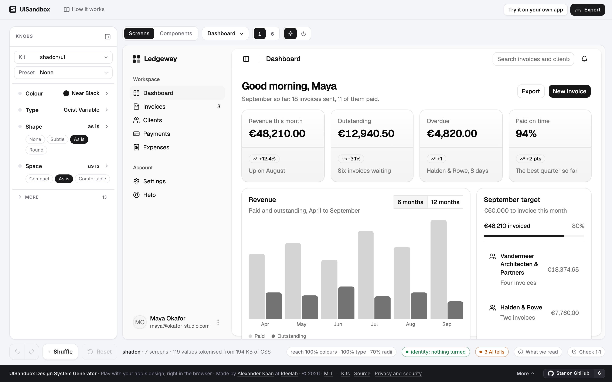
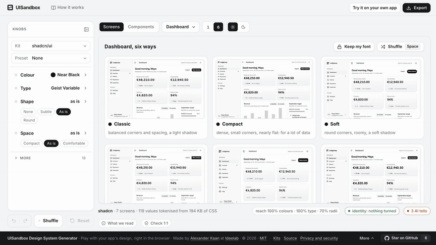

<p align="center">
  <a href="https://uisandbox.org"></a>
</p>

<h1 align="center">UISandbox</h1>

<p align="center"><b>Play with your app's design. Right in the browser.</b><br>
Bring your app, pick a look, tune it, take it home.<br>
<sub>Your own app runs 1:1 in the tab, nothing is sent to a server, and closing the tab undoes all of it.</sub></p>

<p align="center">
  <a href="https://uisandbox.org">uisandbox.org</a> ·
  <a href="https://www.npmjs.com/package/uisandbox-mcp">npm: uisandbox-mcp</a> ·
  <a href="https://registry.modelcontextprotocol.io/v0/servers?search=uisandbox">MCP registry</a> ·
  <a href="https://github.com/Ideelab/uisandbox/discussions">Discussions</a> ·
  <a href="LICENSE">MIT</a>
</p>

<p align="center">
  
  
</p>

Your app looks like every other app an AI helped build, and you cannot say why.
UISandbox opens it next to the knobs that decide that: colour, type, shape and
space. Turn one and every place that value is used follows, on the real app and
not a mock-up of it. Keep what you see as a design system your agent can apply.

Open **[uisandbox.org](https://uisandbox.org)**. It starts on a UI kit, so there is
something to turn before you bring anything.

<p align="center"></p>

## The four steps

1. **Bring your app.** The editor opens on shadcn/ui as it ships, six ways, with
   seven more kits one pick away (Tailwind CSS, daisyUI, Bootstrap, Material 3,
   Radix Themes, Mantine, Ant Design), each dressed as the same seven-screen
   invoicing app. Then *Try it on your own app*: run
   `npx uisandbox-mcp open http://localhost:3000` next to your dev server, or tell
   your agent to open it, and your running app opens live, every screen, hot reload
   included. No terminal? Drag *Take this screen along* to your bookmarks bar and
   click it on any screen your browser shows (staging, behind a login, a Lovable or
   v0 preview), or bring a zip, a folder or a public repo. What you turned on the
   kit comes along if you want it to.
2. **Pick a look.** *6* over the screen shows it six ways, side by side: Classic,
   Compact, Soft, Sharp, Airy and Bold. They differ in corners, spacing, depth and
   type and never in colour, so you compare the style and not the paint. Open one
   full size, then *Pick this one*. The same six are the Preset list.
3. **Tune it.** Colour, Type, Shape and Space first; text size, line height,
   letter spacing, weight, border width, elevation, motion, grey tint and the rest
   under More. Every dial has **×1 = as in your code** at its centre. Your own dark
   mode is switched on your own hooks. Hold Space to see your original.
4. **Take it home.** *Copy for your AI* puts the design system and how to apply it
   in one paste, for Claude Code, Cursor, Codex, Lovable or v0. On a kit, the zip
   keeps a `DESIGN.md`, a `theme.css` and a `SKILL.md` in your repo, written in that
   kit's own variable names. On your own app you get your files patched in place, or
   tokens for CSS, Tailwind, shadcn, Swift and Android. With the MCP server running,
   *Send to your agent* hands it straight back.

It also says which tells of the generic AI look are on the screen (Inter or Geist
everywhere, an indigo brand, gradients as decoration), measured from the page, and
which of them a knob fixes.

### Open one by link

`uisandbox.org/?load=` followed by a public GitHub or GitLab repository URL, or a
direct link to a `.zip` that allows CORS, opens straight into the sandbox:

```
https://uisandbox.org/?load=https://github.com/edwardtufte/tufte-css
https://uisandbox.org/?load=https://example.com/dist.zip
```

A repository URL goes through this site's repo route (GitHub and GitLab do not
send CORS on archives); a `.zip` URL is fetched by the browser itself. Either way
the archive is read in the tab, exactly as a dropped one is.

## It is your app, not a preview of it

Every colour, radius, font, size, spacing, line-height, letter-spacing, weight,
border-width, duration, gradient angle and shadow literal in your CSS becomes a
variable holding the very same value, so the page renders exactly as it was.
Runtime styles too: `style=""` set by JavaScript, the `<style>` your framework
appends, `insertRule` and `replaceSync` from styled-components, Emotion, Lit and
Ant's cssinjs, CDN stylesheets through a same-origin proxy, and nested same-origin
frames such as Storybook's.

## How to check it yourself

- **Check 1:1** loads the untouched and the tokenised page side by side and diffs
  the computed styles of every element, shadow roots and nested frames included.
  Zero differences, or it names what differs.
- **The reach meter** in the stage foot says how much of what you see the knobs
  touch, and what lies outside: images, canvas, video.
- **It says so when it can't help.** iOS and Android projects, WordPress themes and
  source without a build get a clear message at the door.
- **A hostile archive** cannot navigate the tool away, register its own service
  worker or unregister ours, or smuggle a zip-slip path out of an export. What it
  can do, reach the tool's DOM because the frames are same-origin by design, reaches
  nothing worth having: no server, no credentials, no state. Read
  [`notes/security.md`](notes/security.md), and deploy on an origin of its own.

## Your files never leave your browser

There is no server behind the sandbox, no account, no cookies and no analytics.
Your files are read in the tab and served to the frame by a service worker on the
same origin; exports are made there too. The one exception is a public repo URL,
which goes through uisandbox.org to fetch its zip. Nothing is stored.

## From your terminal, or from your agent

```bash
npx uisandbox-mcp open                       # inside your project: finds the build, opens the sandbox
npx uisandbox-mcp open http://localhost:3000 # your running dev server, live, hot reload included
```

The same engine runs as an MCP server ([`mcp/README.md`](mcp/README.md)): `load` a
build, a zip or a running dev server, `open` the real sandbox in the user's browser,
`wait_for_send` for what they turned, `set` knobs, `export` any format, `verify` the
1:1 check and take a `screenshot`. Add it to any MCP client with
`npx -y uisandbox-mcp`.

**Claude Code plugin** (skill and server in one):
`/plugin marketplace add Ideelab/uisandbox`, then `/plugin install uisandbox@uisandbox`,
and say *"open this app in UISandbox"*. The skill alone is
[`skills/uisandbox/SKILL.md`](skills/uisandbox/SKILL.md).

## Run it

```bash
pnpm install
pnpm dev        # http://localhost:5190
pnpm test       # vitest, node:test for the audit and the kit engine
pnpm build      # dist/: static; public/_headers rides along
pnpm holdouts   # every fixture zip through the real app in headless Chromium (below)
```

`http://localhost:5190/?load=<zip-url>` loads a zip by URL (same-origin or CORS).

## Test it against real builds

`pnpm holdouts` runs every archive in `fixtures/` (real builds from public repos,
gitignored; [`notes/decisions.md`](notes/decisions.md) says where each came from)
through the app: load, Check 1:1, reach, and a host check. Verdicts are held against
[`scripts/holdouts.expect.json`](scripts/holdouts.expect.json); a fixture expected
`ok` that is not fails the run. `--only <name>`, `--record`, `--base <url>`.

`pnpm kits:build` builds the eight kit doors from each kit's own package,
`pnpm kits:gates` checks their detection, their export and the live bridge.

## How it works

```
src/
  sandbox/
    rewrite.ts     their CSS and HTML: literals replaced by var(--us-vN), byte-preserving
    table.ts       the substitution sheet: one entry per (kind, value), with its sites
    mapping.ts     knob to their values, RELATIVE to the baseline (identity at rest)
    baseline.ts    the knobs on the stand of THEIR code
    directions.ts  the six looks of Pick a look and Preset
    tells.ts       the AI tells, measured on the screen
    verify.ts      the 1:1 check: raw against identity, computed styles per element
    coverage.ts    the reach meter
    live.ts        runtime style="" and <style> get the same rewrite
    scheme.ts      their dark mode: the hooks in their CSS, switched
  kits/engine/     the kit doors and the design system + skill export, per kit
  public/sw.js     serves a sandbox document's URLs from the page; /__ext/ proxies CDN CSS
  app/ panel/ tokens/ export/ state/ audit/
notes/             decisions (numbered), traps, lessons, security, roadmap
```

## Deploy

One origin, one Cloudflare Worker (`worker/index.mjs`, `wrangler.jsonc`): static
assets from `dist/`, the SPA fallback for `?load=`, http to https and www to apex,
and the `/__repo/` route that fetches a public repo's zip (nothing stored,
same-origin callers only, rate-limited). `public/_headers` keeps `sw.js` uncached
and sets the security headers. A deploy is `pnpm build && npx wrangler deploy`.
Put nothing else on the origin: the sandboxed frames are same-origin by design.

## Contributing

The most useful thing you can send is a build that does not work. See
[CONTRIBUTING.md](CONTRIBUTING.md) for the 1:1 gate a change to the rewriter is
held to, and how to run it against the real builds.

## Who made this

I'm [Alexander Kaan](https://github.com/AlexanderKaan), and I build open-source
tooling for user interfaces. UISandbox came out of the design system generator I
made before it: I could hand somebody a finished kit, but I could not show them
what their own app would look like in it. This does that other half.

Every decision, and every trap I fell into on the way, is in
[`notes/decisions.md`](notes/decisions.md), including the ones I had to undo.
Issues and pull requests are welcome.

---

Made by [Alexander Kaan](https://github.com/AlexanderKaan) at [Ideelab](https://ideelab.nl/) · [MIT](LICENSE)
